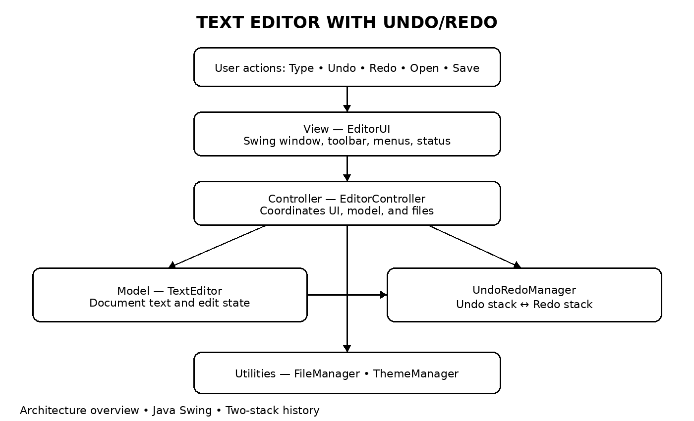

# 📝 Text Editor with Undo/Redo Using Two Stacks

### A Java-Based Text Editor Using Stack Data Structures and Low-Level Design

A lightweight desktop text editor developed using **Java Swing** that demonstrates the practical implementation of the **Stack data structure** through Undo and Redo operations. The application combines a simple graphical interface with a modular architecture to provide essential text-editing functionality.

---

## 📌 Project Overview

The Text Editor with Undo/Redo is a desktop application designed to manage text efficiently while allowing users to reverse or restore editing operations.

The core functionality is implemented using two stacks:

- **Undo Stack:** Stores previous text states so users can reverse changes.
- **Redo Stack:** Stores reverted states so users can restore changes.

The application follows a modular design that separates the user interface, business logic, file management, and history management.

## 🎯 Objectives

- Implement Undo and Redo operations using two stacks.
- Demonstrate the practical application of the LIFO principle.
- Develop an interactive desktop application using Java Swing.
- Apply Low-Level Design (LLD) principles through modular components.
- Support basic document management and text-editing operations.
- Improve code maintainability through separation of responsibilities.

## ✨ Key Features

| Feature | Description |
|---|---|
| **Text Editing** | Create and edit text within a desktop interface. |
| **Undo** | Reverse the most recent editing changes. |
| **Redo** | Restore changes that were previously undone. |
| **New Document** | Start a fresh editing session. |
| **Open File** | Load an existing text document. |
| **Save File** | Save the current document. |
| **Save As** | Save a document under a new name or location. |
| **Keyboard Shortcuts** | Access common editing operations quickly. |
| **Light and Dark Themes** | Switch between available interface themes. |
| **Status Bar** | View useful information about the current editing session. |
| **Unsaved Changes Protection** | Prompt the user before leaving with unsaved changes. |

## 🖥️ Application

The application provides a graphical user interface built with Java Swing.

Users can create documents, edit text, undo or redo changes, open and save files, switch themes, and interact with editing controls through menus, toolbar actions, and keyboard shortcuts.

The interface is designed to keep common editing operations accessible while demonstrating how a stack-based history system works behind the scenes.

### Main Application Capabilities

- Interactive text editor interface
- Undo/Redo history management
- Document creation and file operations
- Keyboard-based editing controls
- Light and dark appearance modes
- User-friendly document handling

## 🔄 Workflow

1. **Launch Application** — Open the desktop text editor.
2. **Create or Open Document** — Start a new document or load an existing file.
3. **Edit Text** — Enter, modify, or remove text.
4. **Save Previous State** — Preserve the previous text state in the Undo Stack before an edit is applied.
5. **Undo Operation** — Restore the previous state and retain the current state in the Redo Stack.
6. **Redo Operation** — Restore a previously undone state and update the Undo Stack.
7. **Save Document** — Save the updated content to a file.
8. **Continue Editing or Exit** — Perform additional edits or close the application, with unsaved changes handled through a prompt.

## 📊 Flow Diagram

The following diagram illustrates the application's editing and history-management process.

The workflow begins when a user edits text. The application manages the previous and current states using two stacks, allowing Undo and Redo operations while maintaining a consistent document state.

## 🏗️ System Architecture

The application follows a modular Model-View-Controller (MVC)-inspired structure.

| Component | Responsibility |
|---|---|
| **Model** | Manages text content, stack operations, and Undo/Redo history. |
| **View** | Displays the graphical editor, menus, toolbar, and status information. |
| **Controller** | Connects user interactions with the editor's operations. |
| **File Manager** | Handles opening and saving text documents. |
| **Theme Manager** | Manages light and dark interface appearances. |
| **Test Module** | Verifies core editor and history-management behavior. |

This separation of responsibilities improves readability, maintainability, and future extensibility.

## 🧠 Core Concept: Two-Stack Undo/Redo

The project demonstrates the **Last In, First Out (LIFO)** principle.

### Undo Stack
Stores earlier document states. When the user selects Undo, the application restores the previous state.

### Redo Stack
Stores states that have been undone. When the user selects Redo, the application restores the next available state.

### History Management

- A new edit records the previous state in the Undo Stack.
- A new edit clears the Redo Stack because the previous redo history is no longer valid.
- Undo transfers the current state to the Redo Stack.
- Redo transfers the current state back to the Undo Stack.
- Undo and Redo are unavailable when their respective histories contain no states to restore.

This approach provides a simple and effective way to manage editing history.

## 🛠️ Technologies Used

- **Programming Language:** Java
- **Graphical User Interface:** Java Swing
- **Data Structure:** Stack
- **Design Approach:** Modular architecture and MVC-inspired separation
- **File Handling:** Java file I/O
- **Testing:** Java-based functional tests
- **Version Control:** Git and GitHub

## 🧪 Testing and Validation

The project includes tests for the core text-editing and history-management logic.

Testing covers:

- Text insertion and modification
- Undo operation
- Redo operation
- Clearing redo history after a new edit
- Stack-based history behavior

These checks help verify that the primary editing operations behave as expected.

## 🌍 Applications

The concepts demonstrated in this project can be applied to:

- Text editors and word processors
- Note-taking applications
- Code editors and IDEs
- Drawing and design software
- Form-editing applications
- Applications that require reversible user actions
- Learning projects involving stacks and software architecture

## 🚀 Future Enhancements

- Search and replace functionality
- Word and character counters
- Multiple document tabs
- Automatic saving and recovery
- More advanced formatting options
- Configurable keyboard shortcuts
- Enhanced editing history and performance

## 📚 Learning Outcomes

Through this project, the implementation demonstrates:

- Practical use of stacks and the LIFO principle
- State management for reversible operations
- Java Swing desktop application development
- Modular software design and separation of concerns
- File handling and user interaction
- Basic testing and version control using Git

## 📥 Download the Application

**Version:** v1.0.0  
**Platform:** Windows / Java-compatible systems  
**Format:** Executable JAR

Download the latest release from the project's GitHub Releases page:

👉 [Download Text Editor](https://github.com/tamil2407/TextEditor-UndoRedo/releases)

### How to Run

1. Download `TextEditor-UndoRedo-v1.0.0.jar` from the release assets.
2. Ensure a compatible Java runtime is installed.
3. Double-click the downloaded JAR file to launch the application.

### Release Features

- Java Swing graphical interface
- Undo and Redo using two stacks
- Open and save text files
- Keyboard shortcuts
- Light and dark themes

## 👨‍💻 Project Information

**Project Title:** Text Editor with Undo/Redo Using Two Stacks  
**Category:** Java Application Development  
**Focus Areas:** Data Structures, Low-Level Design, GUI Development

